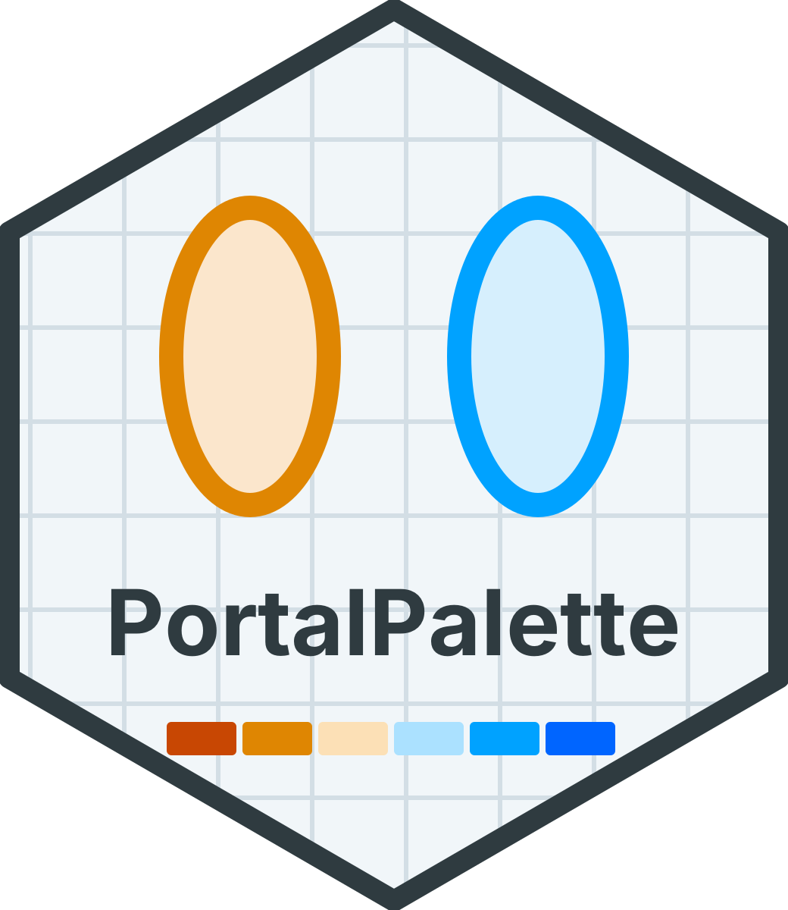
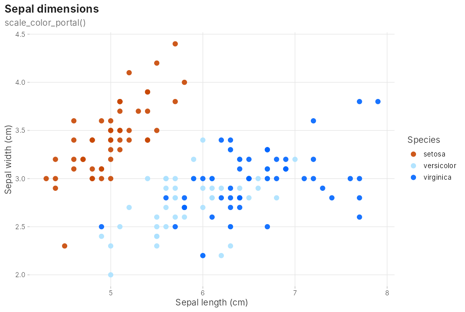
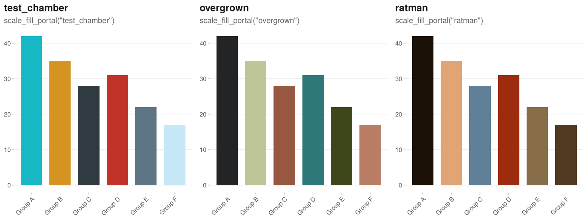
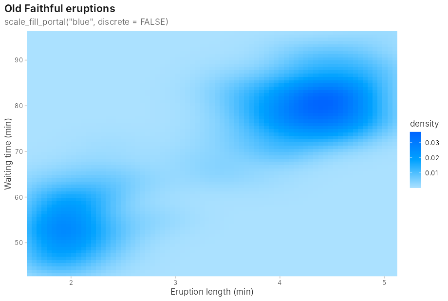
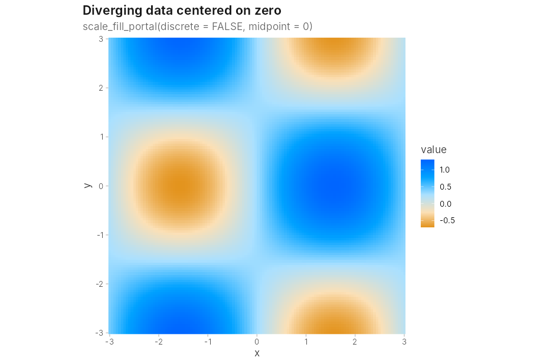

# PortalPalette 

<!-- badges: start -->
[](https://github.com/neuromancer32/PortalPalette/actions/workflows/R-CMD-check.yaml)
<!-- badges: end -->

Color palettes for R and ggplot2, inspired by the Portal games.

- **Diverging:** the default `portal` palette runs orange → tan → blue, tuned so that each orange is as light as its matching blue. That keeps gradients visually balanced around their midpoint, which suits heatmaps of signed data such as log fold change, z-scores or correlations.
- **Sequential:** `orange` and `blue` cover data that only goes one way.
- **Categorical:** `test_chamber`, `overgrown` and `ratman` cover unordered groups such as cell types, conditions or clusters. Their colors were sampled from screenshots of each area, then adjusted so every pair stays distinguishable with common forms of color blindness.


## Installation

```r
# install.packages("remotes")
remotes::install_github("neuromancer32/PortalPalette")
```

## Usage

### Categorical data

Use a categorical palette when groups have no order. Each holds up to 6 groups, and the first colors are the most distinct, so plots with 2–3 groups get the strongest contrast.

```r
library(ggplot2)
library(PortalPalette)

ggplot(iris, aes(Sepal.Length, Sepal.Width, color = Species)) +
  geom_point(size = 3) +
  scale_color_portal("test_chamber") +
  theme_portal()
```





Diverging and sequential palettes also work as discrete scales for *ordered* groups, such as dose levels or time points. With up to as many groups as the palette has colors, they use exact palette colors rather than blends.

### Sequential data

Use `"orange"` or `"blue"` for data that only increases in one direction, such as density, counts or expression.

```r
ggplot(faithfuld, aes(eruptions, waiting, fill = density)) +
  geom_raster() +
  scale_fill_portal("blue", discrete = FALSE) +
  theme_portal()
```



### Diverging data

Set `midpoint` so the light center color sits on a meaningful value. Values below it are orange and values above it are blue, even when the data isn't symmetric around it.

```r
ggplot(df, aes(x, y, fill = log2_fold_change)) +
  geom_tile() +
  scale_fill_portal(discrete = FALSE, midpoint = 0) +
  theme_portal()
```



### Outside ggplot2

```r
portal_colors()                       # named hex codes
portal_colors("blue")
portal_palette(discrete = FALSE)(100) # 100-step gradient, e.g. for pheatmap
```

## Functions

| Function | Purpose |
|---|---|
| `scale_color_portal()`, `scale_colour_portal()` | Color scale for points and lines |
| `scale_fill_portal()` | Fill scale for bars, tiles, rasters and areas |
| `portal_palette()` | Function that generates `n` colors |
| `portal_colors()` | Named hex codes for one palette |
| `portal_palettes_list()` | All palettes |
| `theme_portal()` | Minimal theme to pair with the scales |

Useful scale arguments: `palette`, `discrete`, `reverse`, `midpoint`, `na.value`, and `aesthetics = c("colour", "fill")` to style both with one scale.

## Palettes

| Palette | Type | Use for |
|---|---|---|
| `portal` (default) | Diverging, lightness-balanced | Signed data with a meaningful center |
| `classic` | Diverging, original bright oranges | Matching figures made with version 0.1.0 |
| `orange` | Sequential, light → dark | One-directional data |
| `blue` | Sequential, light → dark | One-directional data |
| `test_chamber` | Categorical, 6 colors | Unordered groups: clean, high-contrast |
| `overgrown` | Categorical, 6 colors | Unordered groups: earthy greens and rust |
| `ratman` | Categorical, 6 colors | Unordered groups: warm, gritty |

## Accessibility

- **Color vision deficiency:** orange vs. blue lies along the blue–yellow axis, which stays distinguishable for the common red–green deficiencies (deuteranopia and protanopia). The closest pair is tan vs. light blue. Every categorical palette was checked so each pair of colors stays distinguishable under deuteranopia, protanopia and tritanopia; `overgrown` has the smallest margin (moss vs. rust), since green against rust is the hardest combination for red–green color blindness.
- **Pale colors:** `test_chamber`'s panel white and `overgrown`'s sage are light, so they suit bars and fills better than small points on a white background.
- **Greyscale:** the sequential palettes keep their order in greyscale. The categorical palettes don't survive greyscale; several pairs become the same grey. The diverging palettes don't: because each orange matches its blue in lightness, greyscale shows *how far* a value is from the midpoint but not *which side* it's on (see the greyscale column above). For printed greyscale figures, use a sequential palette or label the direction explicitly.
